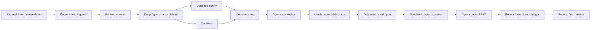

# Active paper investing

A Python agent using Deep Agents for research and LangGraph for the trading workflow for active growth, business-quality and undervaluation research, with days-to-months holding periods and autonomous **paper-only** execution. Alpaca's dedicated paper account is authoritative for orders, fills, cash and positions. SQLite stores the decision journal and a reconciled audit ledger. There is no production execution simulator.

**Status: NO-GO for real money.** Offline tests, paid research evaluations and a broker-confirmed one-share paper fill have been recorded. Research acceptance, financial interpretation, recovery and live-release requirements remain incomplete; a paper fill does not establish investment quality. The deployed executor remains paused. See the current [readiness evidence ledger](docs/live-readiness.md), [acceptance coverage](docs/acceptance.md) and [operations](docs/operations.md).

## Start

Requires Python 3.12+ and `uv` on macOS/Linux. All active processes for an account must share one authorized host, OS user, database and control directory. Cloud deployment also uses an explicit executor-owner guard; a replacement host requires fenced transfer and broker reconciliation, not simultaneous execution.

```sh
uv sync --locked
cp config.example.toml config.toml
```

Edit `config.toml`:

- Set `sec_user_agent` to your application name and contact email.
- The example selects GPT-6.1 Sol for business, valuation and adversarial research; GPT-6 Astra for the research lead; GPT-6.1 Terra for focused catalyst/news review. `role_models` overrides the default model, reasoning effort and token rates by role. Confirm these models are available to your project.
- Verify the common-stock universe, SEC CIKs and sector classifications. The example stocks are configuration examples, not recommendations. Research and ranking cover this configured universe plus any explicit `research_only_universe` entries, not the entire market. Research-only entries cannot submit orders and must not overlap the execution universe.
- Start with `feed = "iex"` for free real-time IEX venue quotes on US stocks, including NYSE- and Nasdaq-listed companies. This is not consolidated market coverage. A later explicit switch to `"sip"` requires the corresponding entitlement; errors never switch feeds automatically. Delayed feeds remain rejected.
- Verify `input_cost_per_million` and `output_cost_per_million` for the default model and each role override. These are budget ceilings, not actual billed rates. The example covers the highest Standard short-context cache-write price (12h), checked on 2026-11-08; cache-read and incentive discounts are not assumed. Reverify ceilings when changing models, context limits, processing tiers or endpoint regions. Research refuses to start without rates because it enforces an estimated spend budget. Record data subscriptions separately using `record-data-cost`.

Create a dedicated Alpaca **paper** account with $100,000 simulated cash (or change `initial_capital` to match). It must have no positions or outstanding orders. Use the paper account's own keys; generic/live Alpaca keys are never read.

Export credentials through your shell or service secret manager:

```sh
export ALPACA_PAPER_API_KEY='your-paper-key'
export ALPACA_PAPER_SECRET_KEY='your-paper-secret'
export OPENAI_API_KEY='your-research-api-key'
uv run paper-agent init
uv run paper-agent reconcile
uv run paper-agent report
```

If credentials are saved in the ignored `.env`, use `uv run --env-file .env paper-agent ...` to load them explicitly. `.env.example` lists variable names; the application deliberately does not load `.env` automatically. Do not commit credentials. The database and control directory must remain persistent. Runtime config is revalidated against the exact paper URL; live URLs, redirects and conflicting Alpaca endpoint environment variables fail closed.

To run the finite research-team → risk → execution → reconciliation workflow:

```sh
uv run paper-agent research AAPL --run-key first-aapl-review
```

**That command can submit a paper order.** It does not ask for manual approval for each trade. Reuse the same run key when retrying an interrupted logical decision; changing its contents under the same key is rejected. The model has no broker tools, no access to credentials, and cannot alter the deterministic risk gate. Missing evidence or model refusals do not become trades.

For isolated research benchmarks that cannot submit orders, see [research evaluation](docs/evaluation.md). Offline replay needs no credentials; model runs require explicit opt-in and share the daily budget.

## Run in Docker on your Mac

Docker must be running and the Mac must stay awake with network access. From this repository, use the wrapper so the container runs as your host user:

```sh
mkdir -p state "$HOME/.local/state/paper-growth-agent"
uv run python deploy/setup-observability.py
./deploy/container.sh build
./deploy/container.sh up -d
./deploy/container.sh ps
./deploy/container.sh logs --tail 30
```

The image contains code/dependencies only. Compose mounts `.env` as a runtime secret, `config.toml` read-only, and the existing ledger/control directories at their original absolute paths. It preserves the initialized experiment; do not run `init` again. Only this container should operate the account—stop any host scheduler/listener first. The current mount layout expects the default `state/ledger.sqlite` and `~/.local/state/paper-growth-agent` paths; custom locations require matching volume mounts.

`restart: unless-stopped` restarts an exited container while Docker is running. Health checks verify recent monitoring and reconciliation; Docker does not automatically restart an unhealthy-but-running container. Health is visible in `ps`; this local Compose setup alone does not configure independent push alerts. The deployed cloud monitor and Telegram fill-notification procedures are documented in [operations](docs/operations.md). Start Docker after a Mac reboot; this setup does not change macOS sleep or Docker login preferences.

Set `research_daily_cost_usd` in local `config.toml`: `0` means monitoring/reporting only; `5` is an example daily pilot ceiling. Model spending uses New York dates and durable per-run reservations. Unknown/crashed runs retain their reserved allowance; an investigation cannot start additional model calls after the New York date changes. Reconciliation, cancellations and reporting continue at the cap; new model research pauses. These are estimates using configured token rates, not a provider-enforced billing guarantee.

```sh
./deploy/container.sh exec -T agent uv run --no-project --env-file /run/secrets/trader_env /opt/venv/bin/paper-agent --config /run/config.toml report
./deploy/container.sh exec -T agent uv run --no-project --env-file /run/secrets/trader_env /opt/venv/bin/paper-agent --config /run/config.toml kill --reason 'Operator pause'
./deploy/container.sh stop
```

`kill` pauses research/new orders and requests cancellation while keeping reconciliation running. `stop` ends all monitoring and does not cancel broker orders. Resume with the CLI `resume` command after reviewing account state. After editing credentials/config, use `./deploy/container.sh up -d --force-recreate`; after code changes, build first. Never run the image or `compose.yaml` from a different working directory without preserving the ledger binding.

## Operate

```sh
uv run paper-agent tick                  # Finite scheduled run
uv run paper-agent listen                # Price, order and news listeners + bounded REST fallback
uv run paper-agent daily                 # After completed regular session
uv run paper-agent kill --reason 'Operator pause'
uv run paper-agent reconcile             # Keep reconciling even while paused
uv run paper-agent resume                # Requires successful reconciliation
```

Use the supplied [systemd timer](deploy/paper-agent.timer), [finite-run service](deploy/paper-agent.service), and optional [stream service](deploy/paper-agent-streams.service), adjusting installation paths. On macOS, invoke `tick` from launchd or cron every minute:

```cron
* * * * * cd /absolute/path/to/trader && /absolute/path/to/trader/.venv/bin/paper-agent --config /absolute/path/to/trader/config.toml tick >> /absolute/path/to/paper-agent.log 2>&1
```

Supply environment variables securely to the scheduler. Installing the Python package does not activate a scheduler. The deployed cloud environment uses systemd; do not start a second listener or timer for its account. The broker calendar controls sessions, holidays, daylight saving and early closes; the machine's cron timezone does not define market hours.

Default cadence: reconcile every minute; research before open; check triggers every 15 minutes during the session; targeted checks on new news; daily report at least 16 minutes after close; deeper research and behavior review Friday after close. Streams only provide wake-up hints. Accounting always comes from REST reconciliation. Reconnects trigger reconciliation; downtime is recorded without fictitious backfilled monitoring.

The kill switch pauses new orders and attempts cancellation. Cancellation can race with a fill. It does **not** liquidate positions. To close a position explicitly, submit a separately documented SELL decision using `execute decision.json --intent-key ...`; the same risk rules apply.

## Engineering defaults

These are initial experiment controls, **not optimized investment parameters**:

| Setting | Default |
|---|---:|
| Initial simulated capital | $100,000 |
| Experiment duration | 12 weeks |
| Entry/addition concentration | 10% of equity |
| Sector concentration | 40% of equity |
| Simultaneous positions | 10 |
| Rolling 30-day gross turnover ceiling | 100% of current equity |
| Repeat-symbol cooldown | 24 hours |
| Limit tolerance from current ask/bid | 0.5% |
| Pending-buy fee buffer | $1 per order |
| Quote maximum age | 60 seconds |
| Estimated model spend per investigation | $5 |
| Suggested estimated daily model spend | $10 (0 disables research) |
| Halt bulletin maximum age | 180 seconds |
| Order expiration | DAY; request cancellation after 30 minutes |

US-listed common stocks only, long only, whole-share orders, limit orders of at least $1, regular sessions only. No leverage, shorts, options, crypto, fractional orders or extended-hours execution. The configured universe is an operator-reviewed allowlist; Alpaca's broad `us_equity` asset class alone does not identify common stocks.

Pending buys count toward cash, symbol, sector, position-count and turnover limits. Pending sells do not free cash or concentration capacity until filled. Internal cash availability uses **broker cash minus pending-buy reservations**, never margin buying power; broker buying power is not subtracted again. Appreciation beyond an entry limit blocks additions and triggers reassessment, not forced liquidation. Discretionary exits retain cooldown/turnover limits. Protective exits for risk, invalidated thesis or failed catalysts bypass those two limits only; pause, ownership, reconciliation, halt, freshness and execution limits still apply.

Review deadlines cause reassessment. Every decision records business/price/timing rationales, catalysts, thesis development time, holding period, review date, add/reduce/exit conditions, evidence, assumptions and expected outcome. Exits can cite thesis failure, valuation, failed catalysts, better opportunities or risk. Cash and HOLD/WATCH are valid outcomes.

## Reports and evidence

Reports identify the configured market-data feed and coverage. IEX slippage references are venue quotes, while Alpaca paper fills use NBBO; these differences are not evidence of live execution skill. Reports include broker holdings/cost basis, cash/reservations, realized and unrealized P/L, fees, capital movements, exposure, turnover, daily equity, drawdown, slippage against the submission quote where available, entry/exit reasons, position-age intervals, rejected decisions and operational errors. Open positions remain held at experiment end; new orders stop and open orders are canceled without forced liquidation.

SPY/QQQ comparisons start at the first recorded regular-session close and use the same matching dates, chosen feed and split-adjusted regular-session marks. Dividends are excluded from both sides; Alpaca paper does not simulate them. Historical benchmark baselines are refreshed for subsequent splits. Portfolio returns adjust explicit cash movements using an end-of-day flow convention; intraday flow timing is approximate. Daily drawdown includes the initial capital baseline. Missing sessions remain visible, and an absent close fails the benchmark report rather than inventing a price.

The research lead delegates to business-quality, catalyst, valuation, and adversarial specialists, each using a Deep Agents tool loop with isolated context. Business/catalyst investigations can run concurrently; valuation and critique enforce prerequisites. Tools retrieve SEC facts, recent material filings and actual filing/earnings-exhibit passages, plus recent Alpaca news. Competitor research is limited to companies in the configured execution and research-only universes. Valuation scenarios are calculated with Decimal arithmetic, not accepted as model arithmetic. See [research architecture and APIs](docs/research.md). XBRL periods, units, restatements and missing information are preserved for assessment; news coverage is bounded and is not proof that no material event occurred. Source text is treated as data, never as execution instructions. Material unresolved objections veto new buying.

Start the 12-week experiment with free IEX data. Review stale-data rejections, missed/partial fills, slippage, drawdown and SPY/QQQ comparisons before considering paid consolidated data. A profitable paper period alone does not establish that an upgrade is worthwhile.

Data/model spending is separate from simulated portfolio returns. Estimated token charges use each role’s configured rates; actual billing may differ. Requests explicitly use Standard processing (`service_tier="default"`); no automatic model fallback or escalation is configured. Operational correctness and investment performance are separate results. A 12-week paper experiment cannot establish reliable long-term alpha. Paper fills omit or simplify real market impact, order queue position, liquidity, fees and dividends.

## Validate

```sh
uv run pytest -q
uv run ruff check trader tests
uv run ruff format --check trader tests
```

Tests use offline broker/data/model fixtures; only the explicit paper smoke test uses the network. After initialization, during regular hours, with a fresh, eligible quote and the kill switch off:

```sh
PAPER_SMOKE=1 PAPER_SMOKE_SYMBOL=AAPL uv run pytest -q -s -m paper
```

This opts into **one paper buy share**, waits up to 180 seconds for a broker-confirmed fill and activity, and requests cancellation if still open. The position stays held. It can fail because a limit order does not fill. Repeating the test uses the same durable smoke intent and cannot duplicate that trade in the same experiment. A passing offline test is never evidence of a broker trade.

## Architecture and source references



`PaperBroker` and `MarketData` protocols are in [models.py](trader/models.py). Broker/data adapters are in [alpaca.py](trader/alpaca.py); durable execution is in [service.py](trader/service.py); [research.py](trader/research.py) builds the finite LangGraph; [research_team.py](trader/research_team.py) implements the Deep Agents lead/specialists and shared budgets; [evidence.py](trader/evidence.py) retrieves SEC sources. Deep Agents and LangGraph run locally and require no hosted service account.

Implementation references: [Alpaca paper semantics](https://docs.alpaca.markets/us/docs/paper-trading), [order IDs and updates](https://docs.alpaca.markets/us/docs/working-with-orders), [activities and pagination](https://docs.alpaca.markets/us/reference/getaccountactivities-2), [stream feeds](https://docs.alpaca.markets/us/docs/real-time-stock-pricing-data), [SEC APIs](https://www.sec.gov/search-filings/edgar-application-programming-interfaces), [OpenAI structured outputs](https://developers.openai.com/api/docs/guides/structured-outputs), [LangGraph graph API](https://reference.langchain.com/python/langgraph/graph).

## Observability

[Postgres telemetry and SQL queries](docs/observability.md) covers correlated
model/tool calls, rejected reports, platform operations and completion/error traces.
Local database: `127.0.0.1:55432`, `observability`, table `telemetry_events`.

## Dashboard

The private [Trader observatory](dashboard/README.md) is a Vercel-deployable Next.js
UI for portfolio performance, research conclusions/evidence, and per-run traces.
Run it locally at `http://127.0.0.1:3000`; hosted deployment needs a reachable
Postgres database shared with the agent exporter.
